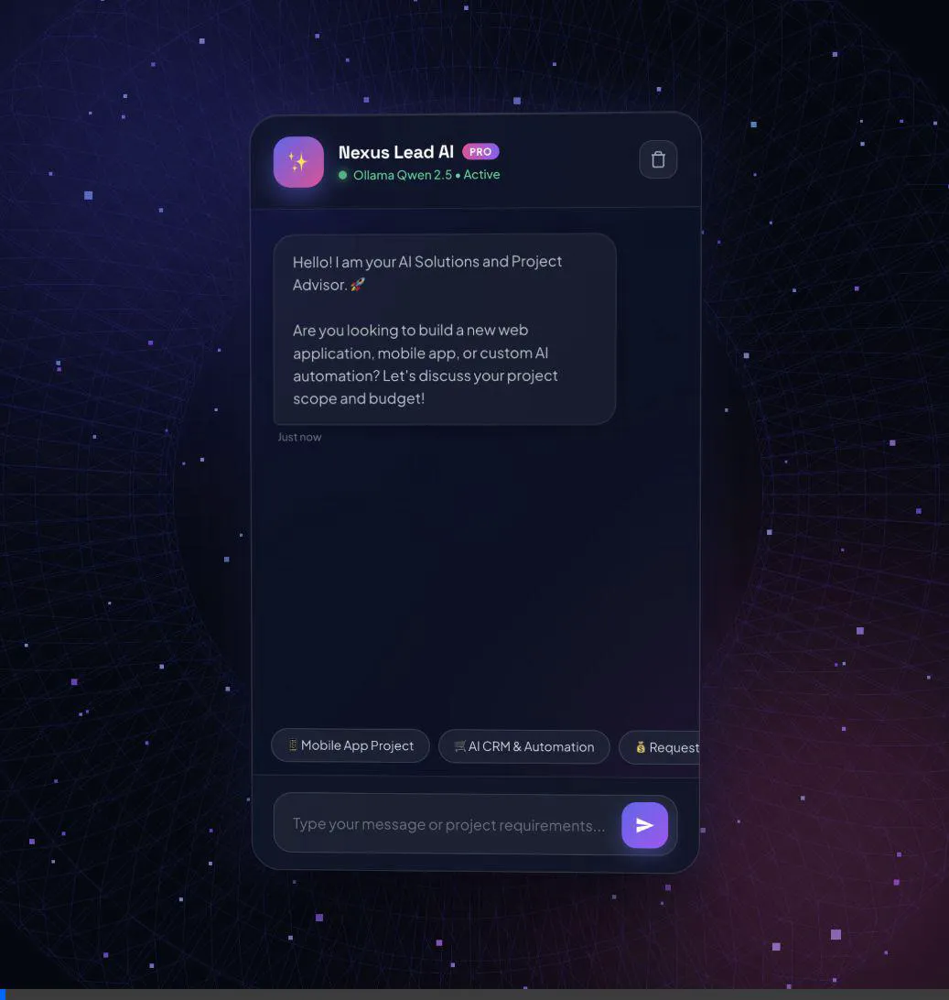
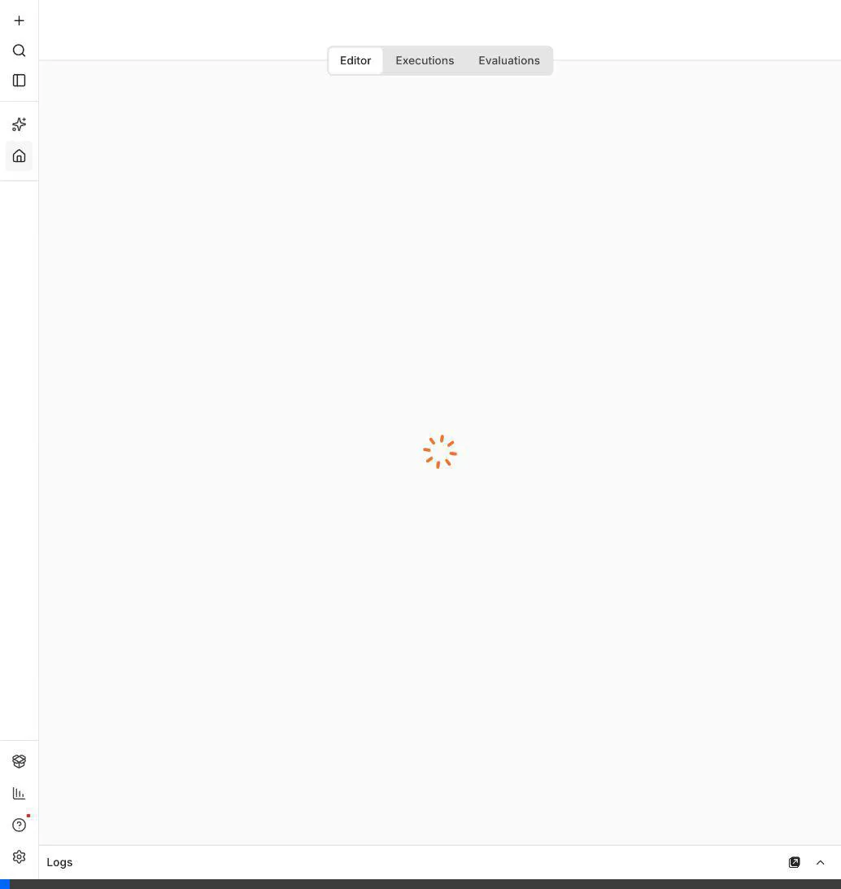
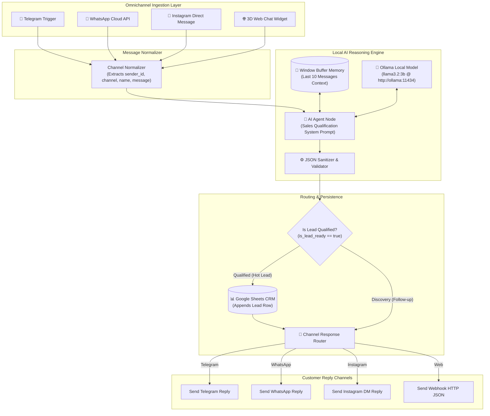
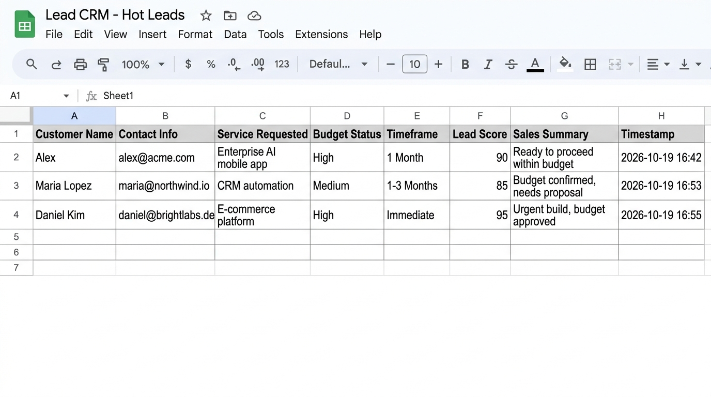

# ⚡ Nexus AI — Self-Hosted Omnichannel Lead Qualification Agent

[](https://n8n.io)
[](https://ollama.ai)
[](https://www.docker.com)
[](https://github.com)
[](https://opensource.org/licenses/MIT)

An enterprise-ready, open-source, and **100% local AI Sales & Lead Qualification Agent**. Built with **n8n**, **Ollama (`llama3.2:3b`)**, **LangChain Buffer Memory**, and automated **Google Sheets CRM synchronization**.

Routes incoming inquiries across **Telegram, WhatsApp Cloud API, Instagram DM, and Web Chat** into a unified conversational reasoning pipeline.

---

## 🎥 Interactive Live Demo & Architecture

### 1. 3D Dynamic Interactive Web Chat (Live Demo Video)
> Powered by Three.js WebGL particle space, real-time lead score badges, dynamic action chips, and synthesized Web Audio chime feedback.

<p align="center">
  
</p>

### 2. End-to-End n8n Workflow Architecture (Live Canvas)
> Unified multi-channel routing, LangChain conversation memory, strict JSON schema enforcement, and conditional CRM logging.

<p align="center">
  
</p>

---

## 🏗️ Architecture Pipeline



---

## ✨ Key Features

- **🔒 100% Private & Self-Hosted:** No proprietary third-party API dependencies or recurring LLM subscription costs. Runs entirely on your own hardware / VPS via Docker.
- **🧠 Context-Aware Conversation Memory:** Retains multi-turn chat history per client using `WindowBufferMemory` partitioned by `channel_sender_id`.
- **🎯 Strict Structured JSON Output:** Uses high-precision temperature controls (`0.2`) and robust regex sanitization to guarantee valid JSON responses.
- **📊 Automatic Google Sheets CRM Logging:** Automatically maps and appends qualified hot leads into designated spreadsheet columns.
- **🌐 4 Channels, 1 Brain (Omnichannel):** Handles Telegram bots, WhatsApp Cloud webhooks, Instagram DMs, and Web chat simultaneously.
- **🎨 Modern 3D Web Chat Interface:** Includes a zero-dependency HTML/CSS/Three.js interactive chat widget ready for website embedding.

---

## 🚀 Quickstart Guide

### 1. Clone the Repository
```bash
git clone https://github.com/your-username/n8n-ollama-lead-agent.git
cd n8n-ollama-lead-agent
```

### 2. Environment Setup
Copy the example environment configuration:
```bash
cp .env.example .env
```

### 3. Launch Docker Infrastructure
Start n8n and Ollama on a shared bridge network (`ai_agent_net`):
```bash
docker compose up -d
```
Verify all services are running:
```bash
docker compose ps
```

### 4. Pull the Local LLM
Pull your model of choice inside the Ollama container (recommended: `llama3.2:3b`; larger models give better reasoning and JSON accuracy):
```bash
docker exec -it ollama ollama pull llama3.2:3b
```

---

## 🔌 n8n Setup & Workflow Import

1. Open your browser and navigate to:
   ```text
   http://localhost:5678
   ```
2. Create your administrative account on first setup.
3. In the top-right menu, select **"Import from File"** and upload:
   - [`workflow_lead_agent.json`](workflow_lead_agent.json) *(Standard Web & Lead Capture)*
   - or [`workflow_omnichannel_lead_agent.json`](workflow_omnichannel_lead_agent.json) *(Full Omnichannel: TG + WA + IG + Web)*
4. Configure credentials:
   - **Ollama Chat Model:** Set **Base URL** to `http://ollama:11434` and select `llama3.2:3b`.
   - **Google Sheets:** Connect your Google account and paste your destination spreadsheet URL.

---

## 📊 Google Sheets Columns Specification

When setting up your Google Sheet, define the following headers in **Row 1 (A1:H1)**:

| A1 | B1 | C1 | D1 | E1 | F1 | G1 | H1 |
| :--- | :--- | :--- | :--- | :--- | :--- | :--- | :--- |
| **Customer Name** | **Contact Info** | **Service Requested** | **Budget Status** | **Timeframe** | **Lead Score** | **Sales Summary** | **Timestamp** |

Qualified leads are appended automatically as new rows (illustrative example with sample data):

<p align="center">
  
</p>

---

## 🧪 Testing via Webhook

You can test the conversational endpoint directly using `curl`:

```bash
curl -X POST http://localhost:5678/webhook-test/lead-chat \
  -H "Content-Type: application/json" \
  -d '{
    "sender_id": "test_user_01",
    "sender_name": "Sarah Connor",
    "phone": "+1-555-0199",
    "message": "Hello, we are looking to build a custom enterprise CRM with mobile app integration. Our budget is around $25,000 and we want to start next month."
  }'
```

### Example AI Agent Output (JSON):
```json
{
  "status": "success",
  "is_lead_ready": true,
  "lead_score": 95,
  "summary": "Enterprise CRM & mobile app request with $25,000 allocated budget starting next month.",
  "reply_message": "Hello Sarah, thank you for reaching out! Your enterprise CRM and mobile app scope aligns well with our capabilities and project timeline. I have scheduled your request with our engineering team who will reach out with a detailed technical proposal."
}
```

---

## 📂 Project Structure

```text
n8n_ollama_lead_agent/
├── docker-compose.yml              # Multi-container stack (n8n, Ollama, Cloudflare tunnel)
├── .env.example                    # Sanitized environment variables template
├── .gitignore                      # Git exclusion rules for secrets and temporary files
├── system_prompt.txt               # Production sales qualification prompt with JSON schema
├── workflow_lead_agent.json        # Main n8n workflow export (Import-ready)
├── workflow_omnichannel_lead_agent.json # 4-channel unified router workflow
├── chat_widget.html                # 3D interactive WebGL test chat interface
├── media/                          # Visual assets, screenshots, and demo recordings
│   ├── chat_widget_screenshot.png
│   ├── chat_widget_demo.webp
│   ├── workflow_canvas.png
│   └── workflow_canvas_demo.webp
└── README.md                       # Comprehensive documentation
```

---

## 🛡️ License & Contributing

Distributed under the **MIT License**. Contributions, issues, and feature requests are welcome!
